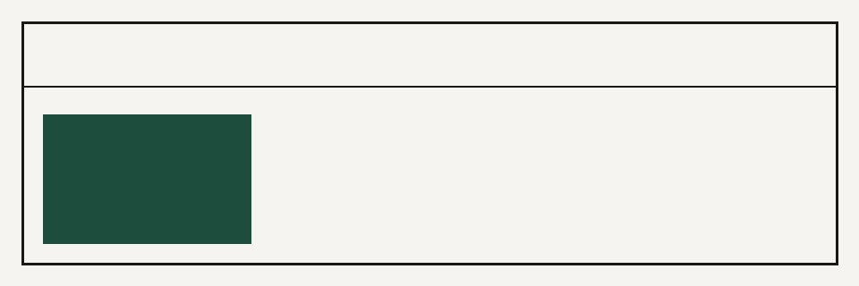

# human-craft

`human-craft` is an open-source Agent Skill and static verification suite for building, auditing, and scrubbing websites, web applications, English and Arabic copy, source code, git repositories, and code-generated motion so that no layer reads as machine-made.



## Why this exists

Code and UI generators converge on the same statistical averages: indigo-to-pink hero gradients, sparkle pills, three identical icon cards, `Inter` or `Cairo` defaults, translated marketing clichés, `href="#"` placeholders, and `lovable-tagger` or `.cursorrules` leftovers. Deleting tells is not enough. `human-craft` pairs every blocked pattern with a specific design or engineering replacement and verifies the result with 16 zero-dependency Node.js scanners.

## Quick start

```bash
# Run the full verification suite against a project directory
node scripts/scan-all.mjs /path/to/project

# Run the unit and pattern test suite
npm test
```

## Repository structure

- [`SKILL.md`](SKILL.md) - Agent entry point, progressive-disclosure routing table, and severity gate.
- [`workflow/`](workflow/00-intake.md) - Seven sequential phases (`00-intake` through `06-handoff`).
- [`references/ai-tells/`](references/ai-tells/00-index.md) - 29 layer-specific catalogs of machine tells and human replacements.
- [`references/directions/`](references/directions/README.md) - 12 distinct design archetypes with Latin and Arabic type pairings and 60/30/10 palettes.
- [`references/localization/`](references/localization/arabic-rtl.md) - Native Arabic typography, logical CSS RTL engineering, and dialect/register guides.
- [`patterns/`](patterns/schema.json) - Machine-readable JSON rule sets validated against `patterns/schema.json`.
- [`scripts/`](scripts/scan-all.mjs) - 16 ESM scanners plus report renderer and metadata scrubber.
- [`examples/`](examples/README.md) - 10 before/after projects with captured `scan-before.json` and `scan-after.json` evidence.
- [`adapters/`](adapters/install.sh) - Drop-in configurations for Claude Code, Claude.ai, Cursor, Codex, GitHub Copilot, Windsurf, Gemini, and Cline.

## License

MIT - see [LICENSE](LICENSE).
